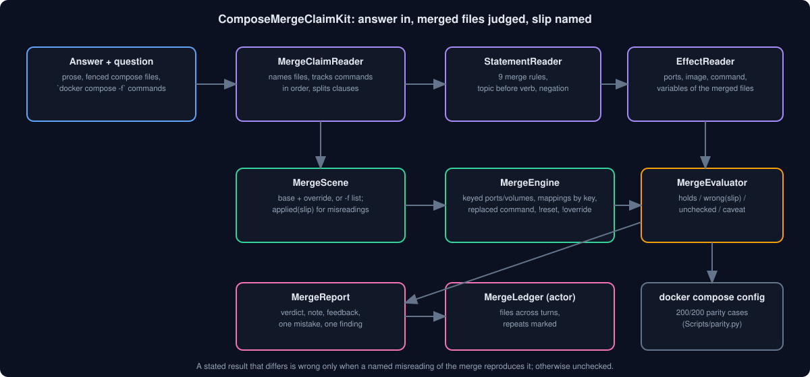
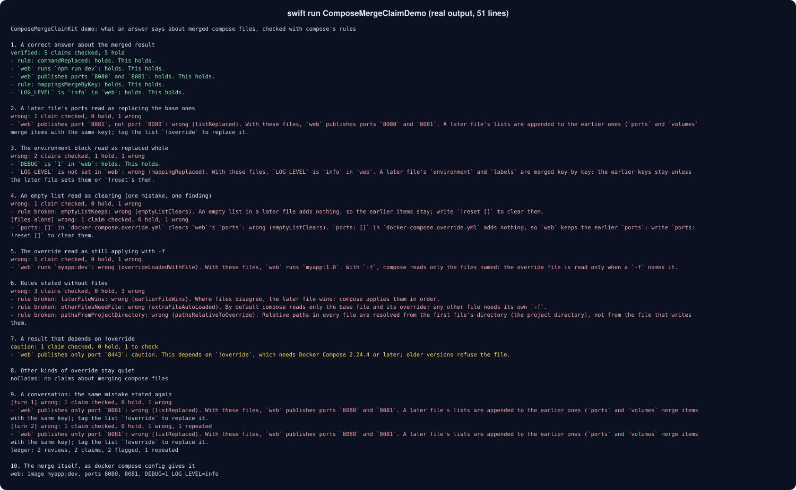
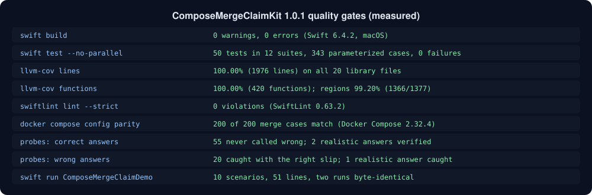

# ComposeMergeClaimKit

An assistant shows you `docker-compose.yml` and `docker-compose.override.yml` and then tells you what the two files do together. That last part is where answers go wrong. "With the override, `web` publishes `8081` instead of `8080`" sounds right, but compose **appends** a later file's `ports`, so `web` publishes both. `ports: []` does not clear the base ports either, and `-f docker-compose.yml` stops compose from reading the override at all. Every one of these answers passes `docker compose config` and only goes wrong when the stack runs.

ComposeMergeClaimKit reads what an answer says about merged compose files and checks it with compose's own merge rules. It merges the files the answer shows, compares the result with what the answer states, and names the mistake behind a wrong claim. It is part of an ecosystem built around [ProviderGatewayKit](https://github.com/rajatslakhina/foundation-model-provider-gateway). Its sibling [ComposeClaimKit](https://github.com/rajatslakhina/compose-claim-kit) checks one compose file (addresses, ports, substitution). This kit checks what happens when several files are merged.



## What it checks

**Stated results**, judged against the merged files:

- the host ports a service publishes ("`web` publishes `8080` and `8081`", "only `8443`", "no longer `8080`", "`8081` instead of `8080`", "replaces `8080:80` with `8081:80`")
- the image a service runs, and its command
- a variable's value, or that it is gone, or still set (`DEBUG` is `1`, `LOG_LEVEL` is removed)

**Merge rules**, stated true or false (9 rules): later files' lists are appended, `environment` and `labels` merge by key, `command`/`entrypoint`/healthcheck `test` are replaced, `key: []` keeps the earlier items, the later file wins, the override is read without `-f`, `-f` reads only the files named, other files (`docker-compose.prod.yml`) need a `-f`, and relative paths resolve from the first file's directory.

**File lines**: a later file's `ports: []` (or any list) under a service an earlier file gives items for. It keeps those items, so it is flagged even when the answer says nothing about it.

## How a claim is judged

The kit merges the files the conversation shows, picked the way compose picks them:

- no `-f`: the base file (`compose.yaml`, `compose.yml`, `docker-compose.yaml` or `docker-compose.yml`) and its override (`compose.override.yaml` and the other three spellings)
- `-f a -f b`: those files, in that order (a sentence's own command first, then the latest command before it)

A file's name comes from the fence's info string, its first comment line, or the line just above the fence (`**docker-compose.override.yml**`). A file without a name takes no part in a merge.

A stated result that matches the merge **holds**. One that does not is **wrong** only when one of eight known misreadings of the merge gives exactly what the answer says. Any other mismatch is **unchecked**. That rule keeps the kit quiet when it cannot tell what the answer meant.

Four of those misreadings (`listReplaced`, `mappingReplaced`, `earlierFileWins`, `overrideNotLoaded`) give what one file says on its own, so a sentence that may just describe one file ("`DEBUG` is `0` by default") is wrong only when it says it is about the merged files ("with both files", "now", "still", "no longer") or runs its own `docker compose` command. `overrideLoadedWithFile` needs the `-f` command in the same sentence. Before any command, an answer that runs compose with `-f` somewhere is unchecked, and a turn that shows compose files is read with those files only.

| Slip | The mistake | What compose does |
|---|---|---|
| `listReplaced` | a later file's list replaces the earlier one | appends it; `ports` and `volumes` merge items with the same key; `!override` replaces |
| `mappingReplaced` | `environment` or `labels` replaced whole | merges them key by key |
| `commandAppended` | `command` added to the earlier one | replaces it (and `entrypoint`, healthcheck `test`) |
| `emptyListClears` | `ports: []` clears the base ports | adds nothing; `!reset []` clears |
| `earlierFileWins` | the first file wins | the later file wins |
| `overrideNotLoaded` | the override needs `-f` | read automatically when no `-f` is given |
| `overrideLoadedWithFile` | the override still applies with `-f` | `-f` reads only the files named |
| `extraFileAutoLoaded` | `docker-compose.prod.yml` is read by default | only a `-f` reads it |
| `pathsRelativeToOverride` | paths in the override resolve from its own directory | from the first file's directory (statements only) |

A result that holds because of `!override` gets a caveat: the tag needs Docker Compose 2.24.4 or later.

A clause about one file ("in the base file, `web` publishes `8080`"), about a change still to make ("add `!override` so `web` publishes only `8081`"), about an expectation ("you might expect ...") or about a question makes no claim. Helm values, Kustomize patches and CSS overrides stay quiet.

## Install

```swift
.package(url: "https://github.com/rajatslakhina/compose-merge-claim-kit.git", from: "1.0.1")
```

```swift
.target(name: "App", dependencies: [.product(name: "ComposeMergeClaimKit", package: "compose-merge-claim-kit")])
```

No dependencies. Swift 6, macOS 13 / iOS 16 / tvOS 16 / watchOS 9.

## Usage

```swift
import ComposeMergeClaimKit

let checker = MergeClaimChecker()
let report = checker.check(answer, context: question)

switch report.verdict {
case .wrong, .caution:
    print(report.note ?? "")          // "Compose merge check: With these files, `web` publishes ports ..."
    let retry = report.feedback       // a message asking the model to fix what it got wrong
case .verified, .unchecked, .noClaims:
    break
}
```

A conversation, where a later answer is read against files shown earlier and a repeated mistake is marked:

```swift
let ledger = MergeLedger()
let first = await ledger.review(answer1, context: question1)
let second = await ledger.review(answer2, context: question2)   // second.repeatedCount
```

The merge on its own:

```swift
let services = checker.merged([baseYAML, overrideYAML])   // [MergedService]? : image, command, ports, environment
```

`MergePolicy.lenient` turns off the file-line check and counts caveats as holding.

## Demo

```bash
swift run ComposeMergeClaimDemo
```

Ten scenarios: a correct answer, each slip, rules stated without files, a `!override` caveat, other kinds of override, a conversation with a repeated mistake, and the merge itself. The output below is the real run (51 lines, two runs byte-identical).



Full text: [Screenshots/demo-output.txt](Screenshots/demo-output.txt).

## Parity with docker compose

`Scripts/parity.py` writes 200 merge cases (30 by hand, 170 generated from a seed) as compose files, runs each through `docker compose -f ... config --format json` (Docker Compose 2.32.4), and records the result as a Swift fixture. A test merges every case with the kit and compares image, command, entrypoint, ports, environment, volumes, expose, dns, labels, `depends_on` and healthcheck `test`: **200 of 200 match**. The cases include `!reset` and `!override` on lists, keys and whole services, three files, long and short port syntax, IPv6 bindings, and an empty service in a later file.

What the oracle showed that the docs do not say:

- `dns` and `expose` are appended **without duplicates**, in first-seen order.
- A `ports:` item merges with an earlier one only when host address, published port, container port and protocol all match (`8080:80`, `127.0.0.1:8080:80` and `8080:80/udp` are three items).
- `command: []` (and `command: ""`) in a later file **does** clear the command, unlike `ports: []`.
- A bare `- LOG` in a later file's `environment` replaces the earlier value with the shell's (unset under `env -i`).
- With two override files present, compose uses `compose.override.yaml` and warns; with two base files, one of them. The kit treats both cases as unchecked.
- Relative paths in `-f sub/override.yml` resolve from the project directory, not from `sub/`.
- A later file's empty `web:` keeps the earlier service as it is.

## Quality

| Gate | Result |
|---|---|
| `swift build` | 0 warnings, 0 errors |
| `swift test` | 50 tests in 12 suites (343 parameterized cases), 0 failures |
| Line coverage | **100.00%** (1976 lines) on all 20 library files |
| Function coverage | **100.00%** (420 functions) |
| Region coverage | 99.20% (1366/1377) |
| `swiftlint lint --strict` | 0 violations (SwiftLint 0.63.2, run for real) |
| Parity | 200/200 cases match `docker compose config` |
| Probes | 55 correct answers never called wrong; 20 wrong answers caught with the right slip; 3 realistic multi-paragraph answers (2 verified, 1 caught); a later turn with a new base file is not read with the old override |



Coverage was measured with `swift test --enable-code-coverage --no-parallel` and `llvm-cov report` on the test bundle ([Screenshots/coverage.txt](Screenshots/coverage.txt)).

## What it does not read

- `extends`, `include`, profiles, `COMPOSE_FILE` (a conversation that sets it is unchecked), and `--project-directory`.
- `env_file:` contents: a variable that may come from one is unchecked.
- Variables (`${TAG}`) in images, commands or values: claims about them are unchecked. ComposeClaimKit checks substitution.
- Port ranges (`8000-8010:80`): claims about that service's ports are unchecked.
- Volumes, secrets and configs are merged (by target) but not yet claimed about.
- Statements come from a fixed lexicon. A correct statement in other words is not read, and a clause with two negations makes no statement.
- A service must be named (`` `web` ``, "the web service") unless only one service fits.

## Architecture

- `MergeClaimReader`: splits the answer into prose and fenced blocks, names compose files, tracks `docker compose` commands in order, and reads statements (`StatementReader`) and stated results (`EffectReader`) clause by clause.
- `MergeScene`: the files shown and the selection; `applied()` gives the files compose reads, and `applied(slip)` the files a slip would read.
- `MergeEngine`: compose's merge (normalised forms, keyed lists, `!reset`, `!override`), or a slip's version of it.
- `MergeEvaluator`: holds, wrong (with the slip a misreading reproduces), unchecked, or a caveat.
- `MergeClaimChecker` (value type) and `MergeLedger` (actor) for single answers and conversations.

All public types are `Sendable` value types except the ledger actor.

## Versions

- **1.0.1** (2026-11-23): "Run `docker compose ...`; <result>" is read. A clause that only runs a compose command no longer makes the sentence an instruction, so the result after it is checked (found by the llm-ecosystem-demo scenario).
- **1.0.0** (2026-11-23): first release.

## License

MIT. See [LICENSE](LICENSE).
